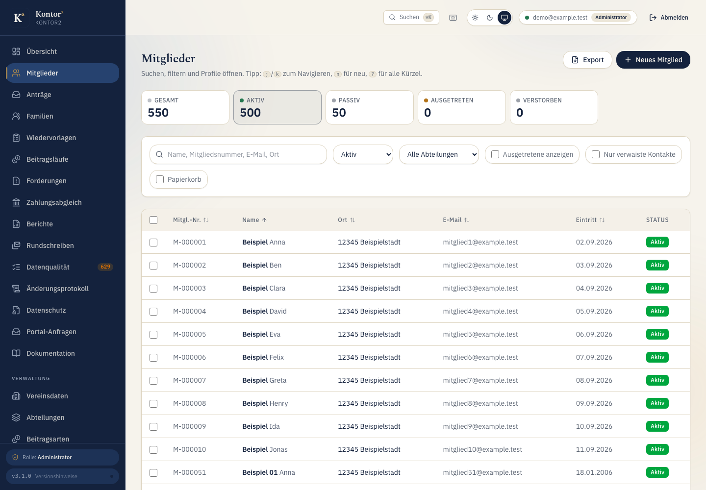

# Kontor2

Kontor2 is a self-hosted administration application for German clubs. It manages members and families, contributions, SEPA direct debits, invoices, correspondence and privacy requests. Each club has its own tenant and branding.

The application also includes member self-service, data-quality checks, snapshots and a role-limited MCP endpoint. See the [feature guide](docs/features.md) for the individual workflows.



Built with Bun, TanStack Start, React, PostgreSQL and Redis. Production runs on Vertex RKE2 with Fleet and Garage object storage.

## Run locally

```bash
bun install
cp .env.example .env
openssl rand -hex 32   # paste into APP_SECRET
bun run dev:up
bun run dev:serve
```

Open <http://localhost:3000>. PostgreSQL uses `127.0.0.1:5434`, so an existing
host database on 5432 stays available. See [local development](docs/local-dev.md)
for the service configuration and data-upgrade instructions.

The first user is created interactively at `/setup`, which is reachable
without auth only while the user table is empty.

## Tests

```sh
bun run test
bun run test:int
bun run verify
```

The integration suite uses a disposable PostgreSQL and Redis instance. See [local development](docs/local-dev.md) and [browser tests](docs/e2e-tests.md).

## Deployment

CI publishes the image to GHCR and Fleet promotes its digest. A Kubernetes init container applies migrations before the app starts. `/api/live` checks liveness and `/api/health` checks readiness. Configuration is documented in [`.env.example`](.env.example).

`APP_SECRET` protects sessions and encrypted application data. See [key rotation](docs/key-rotation.md) before changing it.

## License

Proprietary. Use and deployment require the owner's written permission. See [LICENSE](LICENSE).
